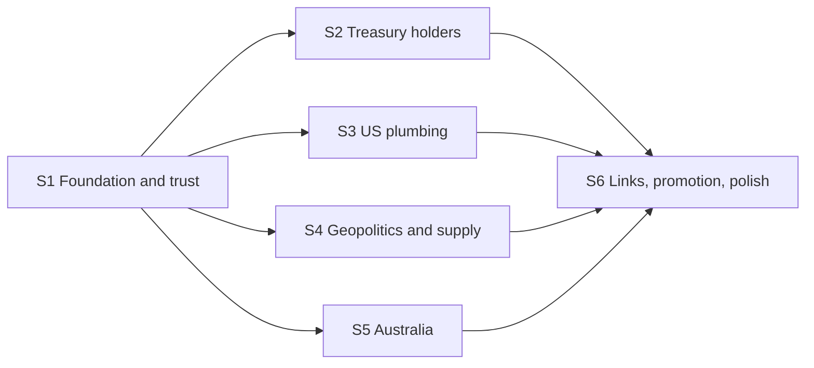

# Currena gap-closure program

A 6-session, 37-milestone plan that closes the gaps found in the 2026-10-31 gap
analysis of the Insights page. Written as a plan only. Implementation happens in
later sessions, one spec per session.

## Goal

Give the owner a reliable, bilingual feel for world economic health (US-centred,
Australia in depth, other regions only as far as they explain the world), without
needing to read the news. Also a product-design portfolio piece, so craft and
honesty matter more than indicator count.

## How to run a session

1. Export credentials in your shell (never paste them in chat):
   `CLOUDFLARE_API_TOKEN`, `CLOUDFLARE_ACCOUNT_ID`. Make sure `git push` works.
2. Open a new agent session in the repo root and paste the matching prompt from
   [`PROMPTS.md`](./PROMPTS.md).
3. The agent follows the spec, ships milestone by milestone (commit, push to
   `main`, deploy, verify), updates [`PROGRESS.md`](./PROGRESS.md), and ends by
   printing the prompt for the next session.

## Files

| File | Purpose |
|---|---|
| [`00-OPERATING-RULES.md`](./00-OPERATING-RULES.md) | Rules for every session: secrets, git/deploy loop, free-tier budget, truth and wording, add-an-indicator recipe, definition of done. |
| [`PROGRESS.md`](./PROGRESS.md) | Live progress: milestone checklist, gap coverage, session log, owner action items. |
| [`VERIFIED-SOURCES.md`](./VERIFIED-SOURCES.md) | What was verified, rejected or still unverified for each data source, with exact URLs. |
| [`PROMPTS.md`](./PROMPTS.md) | The kickoff prompt for each session. |
| [`S1-foundation-and-trust.md`](./S1-foundation-and-trust.md) | Environment, CI diagnosis, stale-voter honesty, RBA continuity, bug fixes, capacity scaffolding. |
| [`S2-treasury-foreign-holders.md`](./S2-treasury-foreign-holders.md) | The priority feature: who holds and who is buying/selling US Treasuries. |
| [`S3-us-plumbing.md`](./S3-us-plumbing.md) | Credit and funding stress, liquidity, term premium, fiscal, nowcast. |
| [`S4-geopolitics-supply-energy.md`](./S4-geopolitics-supply-energy.md) | New geopolitics gauge, chokepoints, supply chain, energy. |
| [`S5-australia.md`](./S5-australia.md) | ABS macro series, Australian gauges, Australian indices board. |
| [`S6-links-promotion-polish.md`](./S6-links-promotion-polish.md) | New Zealand link, China property, de-dollarization, promotion to voters, final polish and case study. |

## Order and dependencies

S1 must go first (it creates the new ingest rung, fixes stale-voter honesty and
verifies Worker egress). S2 to S5 are independent of each other and can be reordered.
S6 must go last.

## Gap map

| Gap (2026-10-31 analysis) | Session |
|---|---|
| Stale Australian voters presented as current | S1 |
| Who holds and who is selling US Treasuries (Japan, China, others) | S2 |
| Credit and funding stress (HY spread was rejected; substitutes) | S3 |
| Fiscal, Treasury supply, auctions | S3 |
| Real-time growth (GDPNow), surveys, median/sticky CPI | S3 |
| Geopolitics gauge, trade policy uncertainty, country GPR | S4 |
| Chokepoints, supply chain pressure, SPR, LNG/coal/TTF | S4 |
| Australian activity and external gauges (GDP, trade, retail, approvals, migration) | S5 |
| Australian indices (All Ords, sectors, A-REIT, volatility, banks) | S5 |
| New Zealand, China property/steel, reserves, concentration | S6 |
| Promotion of shadow indicators to voters, final QA, case study | S6 |

## Out of scope (do not build)

Sources already rejected or without a free licence-clean feed are listed in
`VERIFIED-SOURCES.md`. Existing indicators, indices and countries are never
removed (decision G-3).
